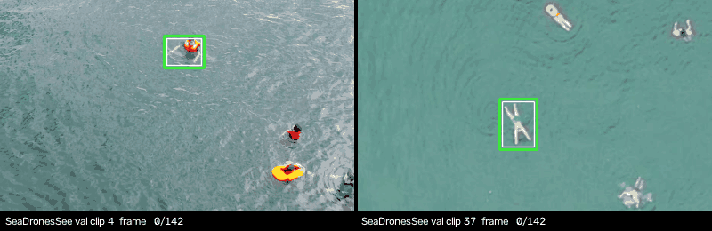
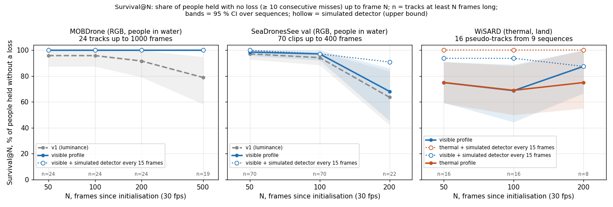

<div align="center">

# dal (달) — a lightweight tracker that keeps a box on a person in search-and-rescue drone video

**Point at a person once (an operator's click or a detector's box) and dal keeps following them, frame after frame, on a $15 Raspberry Pi Zero 2 W. Comes with a long-term "does it lose people?" benchmark.**

[Українська](README.uk.md) · [Responsible use](RESPONSIBLE_USE.md) · [Benchmark protocol](docs/benchmark.md) · [Architecture](docs/architecture.md) · [Datasets](docs/datasets.md) · [Model card (dal-n)](MODEL_CARD.md)

`code: MIT` · `weights: MIT` · `v0.1.0` · `Python ≥ 3.10` · `runtime: numpy + OpenCV (no PyTorch, no GPU)` · `civilian use only`

</div>

---

<p align="center"></p>

<p align="center"><em>The classic tracker (<code>visible</code> profile) on two SeaDronesSee validation clips (CC0), run exactly as in the benchmark: initialised from the ground-truth box of frame 0, then on its own for 142 frames, no detector. Green: dal. Thin white: ground truth. Yellow: recent track. Reproduce with <code>scripts/make_readme_figures.py</code>.</em></p>

A person seen from a drone at 50–120 m is a few pixels wide, and the camera never stops moving. A detector can find them, but on a Raspberry Pi Zero 2 W a small detector needs 0.3–0.6 s per frame, so it cannot run on every frame. **dal** (달, Korean for "moon"; it accompanies the [hae](https://github.com/sashapiscivca-svg/hae) "sun" detector) fills the gaps: given one box, it keeps a box on that person in the following frames, says how confident it is, and says when it has lost them. It is meant to help human searchers confirm a find, not to replace them.

The recommended tracker is **classic and training-free**: a MOSSE correlation filter, a Kalman filter and camera-motion compensation, a few hundred lines of numpy and OpenCV. We also trained a small learned tracker (DalNet, with a spiking motion module) and release it as `dal-n` for research, but **on every benchmark we ran the classic tracker was at least as accurate**, so it is the default.

> [!IMPORTANT]
> dal is a **research release** for **civilian search and rescue**. It loses people and it can hold a confident box on empty background (see [What is not proven](#what-is-not-proven)). It reports image coordinates only: it contains **no flight control, no gimbal or camera control, no geolocation and no "follow the target" logic**, and it must not be wired to automated actions against people. Read [RESPONSIBLE_USE.md](RESPONSIBLE_USE.md) first.

## Contents

- [What dal does](#what-dal-does)
- [Quick start](#quick-start)
- [Results](#results)
- [Speed](#speed)
- [How it works](#how-it-works)
- [The learned tracker (dal-n)](#the-learned-tracker-dal-n)
- [Reproducing the numbers](#reproducing-the-numbers)
- [Data](#data)
- [What is not proven](#what-is-not-proven)
- [Repository layout](#repository-layout)
- [License](#license) · [Citation](#citation) · [Acknowledgements](#acknowledgements)

## What dal does

| | |
|---|---|
| Input | video frames (grayscale or RGB, any size) and one initial box `(x, y, w, h)` of the person to follow |
| Output per frame | a box, a confidence in [0, 1] and a `lost` flag |
| Corrections | `correct(box)` / `correct_from(detections)` take a new box from a detector without resetting the tracker |
| Profiles | `visible` (RGB, e.g. people in water) and `thermal` (LWIR), chosen from held-out results |
| Benchmarks | short-clip recall / precision / F1, and **Survival@N** long-term holding with bootstrap confidence intervals |
| Not included | identification, re-identification across videos, any vehicle, camera or gimbal control, geolocation |

## Quick start

```bash
git clone https://github.com/sashapiscivca-svg/dal && cd dal
pip install -e .                        # runtime: numpy + opencv-python-headless only
```

Command line (the initial box is `x,y,w,h` in pixels of the first frame, top-left corner):

```bash
dal track flight.mp4 --init 812,430,22,18 --out tracked.mp4 --json track.json   # profile chosen from the video: thermal for gray, visible for colour
dal track frames/ --init 812,430,22,18 --profile thermal --ego-scale 0.3          # an image folder; faster camera-motion estimate for a Pi
dal info                                                                         # version and profiles
```

`dal track` downscales the frames so that the initial box is about 24 px, the size the tracker was tuned for (`--target-px`), and writes boxes back in original pixels.

Python:

```python
from dal import make_tracker

trk = make_tracker("visible")              # or "thermal"; any ClassicTracker setting can be overridden
trk.init(frame0, (cx, cy, w, h))           # frames: uint8 (H, W) or (H, W, 3) RGB
for frame in frames:
    r = trk.step(frame)                    # {"box": (cx, cy, w, h), "conf": 0..1, "lost": bool}
    if detector_ran_on_this_frame:
        trk.correct_from(detections_cxcywh)   # nearest detection inside a gate; keeps velocity, re-learns the filter after a loss
```

With periodic detector corrections we recommend (preliminary, see [benchmark](docs/benchmark.md#detector-corrections)) `make_tracker("visible", **dal.classic.WITH_DETECTOR)`.

## Results

All numbers come from the documented runs of this project (one run each, no retraining between them); the protocols and exact commands are in [docs/benchmark.md](docs/benchmark.md). The tracker is initialised with the ground-truth box of frame 0 and then runs on its own. A frame is a **hit** by IoU when IoU ≥ 0.5, and by **centre** when the predicted centre is within half the larger side of the target box + 2 px of its centre (IoU is too strict for 6–25 px targets: on a 12 px target a 3 px offset already brings it down to 0.6). Recall counts hits over all frames; precision counts hits over the frames where the tracker did not declare a loss.

### Short clips: classic vs learned

F1 by IoU / F1 by centre, share of frames declared lost in brackets. Settings were chosen on every third clip of SeaDronesSee and MOBDrone (the other two thirds, held out, led to the same choices) and on separate WiSARD tuning locations; the WiSARD rows below were never used for tuning.

| Evaluation set (clips; frames) | classic `v1` (luminance + Kalman) | classic `thermal` (luminance, no Kalman) | classic `visible` (gradients + Kalman) | learned `dal-n` (sensitive, `lost_thr` 0.03) |
|---|---|---|---|---|
| SeaDronesSee val, people in water, grayscale (70; 13,312) | **0.778** / 0.931 (0.08) | 0.767 / 0.937 (0.06) | 0.765 / **0.964** (0.02) | 0.734 / 0.913 (0.04) |
| MOBDrone, people in water, RGB (119; 33,423) | 0.417 / 0.979 (0.04) | 0.416 / 0.976 (0.04) | **0.472 / 0.997** (0.00) | 0.387 / 0.837 (0.14) |
| WiSARD thermal, held-out locations (20; 2,398) | 0.523 / 0.739 (0.03) | **0.529 / 0.794** (0.04) | 0.474 / 0.701 (0.00) | 0.339 / 0.545 (0.06) |
| WiSARD thermal "hard", held-out locations (52; 3,843) | | **0.627 / 0.841** | | |

How to read this:

- **On people in water (RGB), the classic tracker keeps the centre on the person in 96–99.7 % of frames.** Gradient features (`visible`) help most where it matters, on the hardest clips: on the worst quarter of SeaDronesSee clips the centre F1 rose from 0.760 to 0.883.
- **Box accuracy is limited by size, not by position.** The box size is taken from frame 0; with the true size substituted, F1 by IoU would rise by at most about 0.06–0.20. Scale estimation did not help on held-out data and is off.
- **Thermal footage is much harder** (centre F1 0.79–0.84). Features that won on tuning locations lost on held-out ones, so the `thermal` profile stays the plain one.
- **The learned dal-n never beat the classic tracker.** With the default (balanced) threshold it scores 0.750 / 0.866 on SeaDronesSee val. It was trained for 1,500 steps on a single seed, so this says "not at this budget", not "never".

### Long-term holding: Survival@N

Short clips do not show whether a person is lost after 20 seconds. **Survival@N** is the share of people still held without a loss at frame N (a loss is ≥ 10 consecutive frames with the centre off the person), among tracks at least N frames long, with 95 % confidence intervals from a bootstrap over sequences.

<p align="center"></p>

| Dataset (tracks) | Tracker | Survival@100 | Survival@200 | Survival@500 | Mean time to first loss |
|---|---|---|---|---|---|
| MOBDrone (24 tracks up to 1000 frames) | `visible` | 100 % [100–100] | 100 % [100–100] | **100 % [100–100]** (n=19) | 677 frames (22.6 s); 92 % of tracks never lost |
| | `v1` | 96 % [88–100] | 92 % [79–100] | 79 % [58–95] (n=19) | 593 frames |
| SeaDronesSee val (70 clips up to 400 frames) | `visible` | 97 % [92–100] | 68 % [45–86] (n=22) | | 169 frames |
| | `visible` + detector every 15 frames (simulated) | 97 % [93–100] | 91 % [78–100] (n=22) | | 184 frames |
| WiSARD thermal (16 tracks, 9 sequences) | `thermal` | **69 % [50–88]** | 75 % [55–100] (n=8) | | |
| | `visible` | 69 % [44–89] | 88 % [67–100] (n=8) | | 199 frames; 86 % of losses "confidently wrong" |
| | `thermal` + detector every 15 frames (simulated) | 100 % [100–100] | 100 % [100–100] (n=8) | | |

What we learned:

- **On RGB water footage the tracker holds people for the whole length of our tracks (up to 1000 frames, 33 s).** With gradient features no MOBDrone track was lost by frame 500, and the p95 centre error stayed about 12 px (0.4 of the target size) at 500–1000 frames.
- **On thermal footage about one person in three is lost within 100 frames**, and most of those losses are silent: the tracker keeps a confident box on the background.
- **Our own anti-drift mechanisms did not help.** Forward-backward checks, multi-hypothesis peak choice, a filter memory bank and re-capture gave no gain of at least 1 point in Survival@N, so they ship as switched-off options.
- **Periodic detector corrections are what helps**, but here they are simulated from the ground truth plus noise (an upper bound: no misses, no false detections). **A real detector in the loop is not yet evaluated in this release.**

The full per-run summaries (drift by track age, false captures, re-acquisition) are in [`results/survival_reference.json`](results/survival_reference.json).

### Checking the published commands

To confirm that this repository reproduces the original code, we downloaded 13 SeaDronesSee validation clips (`--clips 1-4,33-41`, 1,846 frames) and ran `dal bench` and the original research code on them. The classic profiles gave **identical** numbers (to 6 decimals): `v1` F1 0.823 (IoU) / 1.000 (centre), `thermal` 0.820 / 1.000, `visible` 0.837 / 1.000, all with 0 % lost; the released ONNX `dal-n` matched the original PyTorch checkpoint (0.807 / 0.930, 7 % of frames lost). This easy subset is not the full benchmark: on all 70 clips the numbers are the ones in the table above. See [docs/benchmark.md](docs/benchmark.md#quick-check).

## Speed

| Hardware | What | Time per frame (p50) |
|---|---|---|
| x86 laptop CPU (Intel Core i3-1115G4), 1 thread | classic `v1` / `thermal`, 640×512, including camera-motion estimation | 2.2–2.3 ms |
| x86 laptop CPU, 1 thread | classic `visible` (5 feature channels) | 3.6 ms |
| **Raspberry Pi Zero 2 W**, 1 thread, measured on the device | classic `thermal`, one track, 640×512 WiSARD thermal frames | **31 ms** (p95 36 ms) |
| **Raspberry Pi Zero 2 W**, 1 thread, measured | classic `visible`, one track | **53 ms** (p95 54 ms) |
| **Raspberry Pi Zero 2 W**, measured | learned `dal-n`, network step only (ONNX Runtime), 1 / 4 threads | 21.4 / 10.8 ms |

The Pi was a Zero 2 W Rev 1.0 (Raspberry Pi OS Bookworm 64-bit, Python 3.11, OpenCV 5.0, no heatsink). The Pi was 20–30 times slower than the laptop, not the 8–15 times we had assumed. A profile on the Pi showed that phase correlation for the camera motion took 74 % of a tracker step; downscaling it to 0.3 instead of 0.5 (`ego_scale=0.3`, FFT-friendly sizes) cut that part from 29 to 20 ms per frame without a measurable loss on the thermal hard set (centre F1 0.846 vs 0.842). The whole tracker step was not re-measured after that change. Several tracks cost about the same per track (4 thermal tracks: 125 ms). Power was not measured.

## How it works

```
frame t ──► camera motion: phase correlation between frames t-1 and t (downscaled)  ──► (dx, dy)
         ──► Kalman predict (constant velocity, + camera shift, damped while lost)    ──► predicted centre
         ──► 48×48 patch around the prediction ──► MOSSE correlation filter          ──► peak offset + PSR confidence
         ──► Mahalanobis gate ──► Kalman update ──► filter update (only when found)   ──► box, conf, lost
detector box (optional, every K frames) ──► correct(): Kalman measurement / re-initialise the filter after a loss
```

- **MOSSE** (Bolme et al., 2010) learns a correlation filter in the Fourier domain from the first patch and keeps adapting it. The peak-to-sidelobe ratio of its response is the confidence; below 0.25 of the reference the frame is declared lost.
- **Camera motion** comes from phase correlation of whole frames, with no learning, and shifts the prediction.
- **Kalman filter** (constant velocity) smooths and predicts. Its settings came from a failure analysis: a weak velocity prior, a velocity clamp, a gate, and velocity damping while lost. Before these, a single bad measurement could send the box flying at 15 px per frame.
- **Profiles**: `visible` adds four gradient-orientation channels to the filter (HOG-like, numpy only); `thermal` uses luminance and skips the Kalman filter, which did best on held-out thermal locations.

Details, options and the design decisions behind them: [docs/architecture.md](docs/architecture.md).

## The learned tracker (dal-n)

DalNet is a 36,639-parameter Siamese tracker: a shared backbone correlates the template with a search crop, and a **spiking motion module** (leaky integrate-and-fire neurons) reads frame differences and keeps its membranes between frames as motion memory. It runs inside the same Kalman / camera-motion loop. The ONNX export keeps the motion state as explicit inputs and outputs, so it runs without PyTorch (`pip install -e ".[onnx]"`):

```bash
dal track flight.mp4 --init 812,430,22,18 --tracker onnx --model models/dal-n
dal bench short data/sds_val --tracker onnx:models/dal-n --kw '{"lost_thr": 0.03}'
```

Findings, honestly: on synthetic sequences the spiking module beat a non-spiking twin with the same parameters by 0.022 NWD-AUC (two seeds; 0.701 vs 0.679), but the twin is a different nonlinearity, so this does not prove that spikes help. On a CPU, spikes give no speed-up (0.8 ms vs 0.8 ms per step). On real clips the classic tracker was better everywhere (table above). We release dal-n because the comparison is part of the result; see [MODEL_CARD.md](MODEL_CARD.md) for training data, recipe and limits.

## Reproducing the numbers

```bash
pip install -e ".[bench]"                                                              # + pycocotools for AP
python scripts/prepare_seadronessee.py --split val --out data/sds_val                    # 70 clips; downloads only the needed frames (CC0)
dal bench short    data/sds_val --tracker classic:v1 --tracker classic:thermal --tracker classic:visible --json runs/sds_short.json
dal bench survival data/sds_val --tracker classic:v1 --tracker classic:visible --json runs/sds_survival.json
dal bench survival data/sds_val --tracker classic:visible --kw '{"corr_hard": 2.0, "corr_reinit": true, "recapture": true}' --correct-every 15
```

MOBDrone and WiSARD clips are built from the original downloads (`scripts/prepare_mobdrone.py`, `scripts/prepare_wisard_ir.py`, the latter needs scipy); their selection rules and the remaining commands are in [docs/benchmark.md](docs/benchmark.md). Any folder of your own clips works too (`groundtruth.txt` with `x,y,w,h` per frame, or an `.npz`), see [docs/benchmark.md](docs/benchmark.md#your-own-clips).

## Data

dal uses only **civilian, openly licensed** data that allows commercial use and derivative works. No images are redistributed in this repository, except the README animation made from SeaDronesSee (CC0) frames.

| Dataset | Licence | Used for |
|---|---|---|
| [SeaDronesSee](https://github.com/Ben93kie/SeaDronesSee) (SOT) | CC0 1.0 | benchmark (70 val clips), real training windows for dal-n (train clips), README animation |
| [MOBDrone](https://doi.org/10.5281/zenodo.5996890) | CC BY 4.0 | benchmark only (119 short clips, 24 long tracks) |
| [WiSARD](https://sites.google.com/uw.edu/wisard) (thermal part) | MIT | benchmark only (pseudo-tracks from detection labels) |
| [HIT-UAV](https://doi.org/10.5281/zenodo.7633134) | CC0 1.0 | person patches and backgrounds for synthetic training sequences (dal-n); synthetic test sequences |
| [AIResQ Benchmark](https://doi.org/10.5281/zenodo.17405074) | CC BY 4.0 | person patches and backgrounds for synthetic training sequences (dal-n) |

Rejected datasets (non-commercial, unclear licence, military origin) and attribution: [docs/datasets.md](docs/datasets.md) and [NOTICE.md](NOTICE.md).

## What is not proven

- **Thermal tracks are pseudo-tracks.** WiSARD has detection labels, not tracks; we linked boxes across frames by overlap. Some clips jump between people, and only 9–11 independent sequences (3 held-out locations) are behind the thermal numbers. Hand-labelled long thermal tracks do not exist in open data as far as we know.
- **Small samples, single runs.** Every number is one run of one configuration. Survival@N uses 16–70 tracks; at N = 200 on WiSARD only 8 tracks are long enough. The intervals are wide.
- **SeaDronesSee train and val come from the same lake**, and MOBDrone clips from one video are correlated (the bootstrap groups MOBDrone by video, but SeaDronesSee clips that share a video are treated as independent).
- **Detector corrections are simulated** from ground truth with noise. A real detector misses people and raises false alarms; no real detector in the loop is evaluated in this release.
- **Learned tracker:** one seed, 1,500 training steps, a partly synthetic training set (person patches pasted on real backgrounds). The spiking-vs-non-spiking comparison is on synthetic sequences only.
- **Pi timing** was measured for the tracker before the camera-motion speed-up, on one board without a heatsink; the full tracker step after the speed-up and the power draw were not measured.
- **Not evaluated:** people on land in RGB, crowds and people crossing each other, night RGB, heavy rain or fog, targets smaller than about 6 px, frame rates other than 30 fps, radiometric thermal input.

## Repository layout

```
src/dal/            the package: classic tracker (dal.classic), Kalman, camera motion, metrics, Survival@N, clips, benchmarks, CLI
src/dal/learned/    the learned tracker (PyTorch): DalNet, LIF neurons, synthetic data, training, stateful ONNX export
src/dal/datasets/   SeaDronesSee selective download (HTTP Range), MOBDrone track parsing, WiSARD pseudo-track linking
models/dal-n/       released learned model: ONNX step + template graphs, safetensors, config.json (+ models/SHA256SUMS)
results/            Survival@N summaries of the documented runs (source of the figure and the table)
scripts/            prepare_seadronessee / prepare_mobdrone / prepare_wisard_ir, build_sds_windows, train, export_onnx, make_readme_figures
tests/              unit and smoke tests on synthetic data (pytest; no datasets needed)
docs/               architecture, benchmark protocol, datasets
```

## License

- **Code and the dal-n weights:** [MIT](LICENSE). You may use, modify and redistribute them, including commercially, as long as you keep the copyright notice.
- **Third-party data:** see [NOTICE.md](NOTICE.md). The README animation shows SeaDronesSee frames (CC0 1.0).
- We ask, without any legal force, that dal be used only for saving lives. See [RESPONSIBLE_USE.md](RESPONSIBLE_USE.md).

## Citation

```bibtex
@software{dal_2026,
  title   = {dal: a lightweight single-object tracker and long-term holding benchmark for search-and-rescue drones},
  author  = {{The dal authors}},
  year    = {2026},
  version = {0.1.0},
  license = {MIT},
  url     = {https://github.com/sashapiscivca-svg/dal}
}
```

Please also cite the datasets you use ([NOTICE.md](NOTICE.md) lists the references).

## Acknowledgements

This work stands on openly shared data. We thank the authors of SeaDronesSee, MOBDrone, WiSARD, HIT-UAV and AIResQ for releasing their datasets under permissive licences, and the communities behind NumPy, OpenCV, PyTorch and ONNX Runtime.
